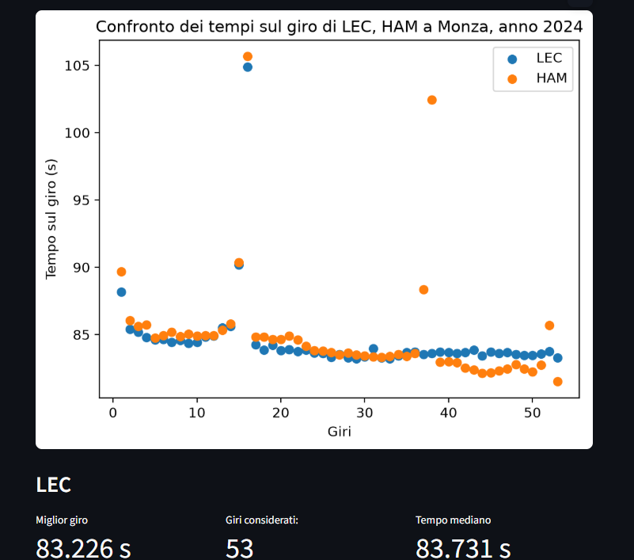
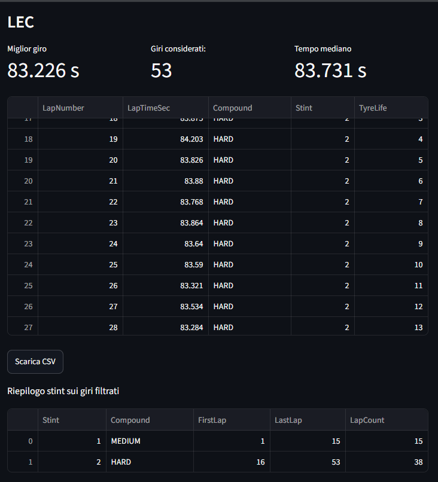

# F1 Dashboard

La Dashboard presente permette di visualizzare tempi sul giro e stint dei piloti scelti dall'utente. Confronta e filtra i giri in base alle richieste dell'utente: giri accurati, scelta delle mescole, scelta degli intervalli di giri. Gli strumenti usati sono: Python, FastF1, pandas, matplotlib e Streamlit.

Stato: in sviluppo (fase 3: Dashboard Streamlit).

## Funzionalità

- Scegliere i dati della sessione che si vuole visualizzare.
- Scegliere se vedere i giri accurati.
- Selezione di più piloti e il confronto dei loro tempi sul giro nello stesso grafico.
- Filtrare la mescola delle gomme, possibilità di scegliere più mescole, tramite selezione.
- Filtrare l'intervallo dei giri della gara, inclusi gli estremi, tramite slider.
- Visualizzazione dei dati sui giri in versione tabella e grafico.
- Possibilità di scaricare le informazioni sui giri di un singolo pilota in formato CSV (Comma-Separated Values) dopo l'applicazione dei filtri.
- Possibilità di leggere in maniera rapida, miglior tempo sul giro, numero di giri considerati e tempo mediano, calcolati sui dati filtrati.
- Tabella riepilogativa che mostra mescola, primo e ultimo giro e numero di giri per stint. La tabella riguarda i dati dopo l'applicazione dei filtri. Può rappresentare solo una parte dello stint

## Anteprima

Gara di Monza 2024, con filtro dei giri accurati disattivato.





## Installazione e avvio

Ambiente utilizzato: Windows, PowerShell e Python (3.13).
Per chi ha già scaricato il progetto e aperto il terminale nella propria cartella, deve:

Creare l'ambiente virtuale nella cartella `.venv`:

```powershell
py -3.13 -m venv .venv
```
Attivare l'ambiente virtuale:

```powershell
.\.venv\Scripts\Activate.ps1
```
Installare le dipendenze elencate in requirements.txt:

```powershell
python -m pip install -r requirements.txt
```
Creare la cartella della cache:

```powershell
New-Item -ItemType Directory -Force data/cache
```

Autenticarsi con un account F1 TV per scaricare le sessioni

```powershell
python -m fastf1 auth f1tv --authenticate
```

Avviare Streamlit:

```powershell
python -m streamlit run app.py
```

## Test

I test utilizzano dati sintetici e non richiedono autenticazione né dati F1 scaricati. Possibile effettuare il testing dalla cartella principale del progetto con l'ambiente virtuale attivo tramite il comando:
```powershell
python -m pytest
```

## Limiti attuali

Per scaricare i dati delle sessioni, è necessario autenticarsi con un account F1 tramite FastF1. Nelle prove effettuate è stato possibile scaricare nuove sessioni senza un abbonamento F1 TV attivo. L’accesso ai dati non è stato verificato per tutte le sessioni. La cartella data/cache è esclusa dal repository: i dati delle sessioni vengono scaricati al primo caricamento e riutilizzati nei caricamenti successivi.